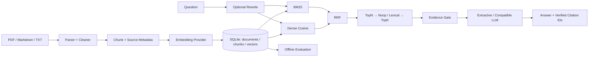

# RAG Knowledge Engine

[](https://github.com/FouHe0720/rag-knowledge-engine/actions/workflows/ci.yml)

**可检查检索过程、可回溯原文的 Citation RAG 知识库。默认 CPU 离线运行，无需 Key、GPU 或模型下载。**

项目解决“小型技术知识库能检索到什么、答案引用从哪里来、检索变更如何评测”的工程问题。实现从 PDF/Markdown/TXT 摄取、清洗、分块、向量持久化，到 BM25 + Dense、RRF、重排、证据门槛、引用与评测的完整链路，没有隐藏在一行框架 retriever 中。

> **English overview:** An inspectable, offline-first citation RAG engine with atomic SQLite ingestion, BM25/NumPy dense retrieval, reciprocal rank fusion, pluggable reranking, source-bound citations, a FastAPI demo, and auditable evaluation fixtures. Hash embeddings are explicitly MOCK. Real embedding and chat services are opt-in through an OpenAI-compatible API; no model quality or production-scale claim is implied.

## 能力与边界

- 文档保存安全相对路径、1-based PDF 页码 / Markdown 标题路径 / TXT 段落、chunk hash、清洗后字符 offset；源文件不变时重复摄取为 no-op。
- SQLite 事务同时替换文档、chunk 和向量；失败保留旧版本，删除级联清理索引。模型、显式 revision、维数、分块/清洗版本绑定索引，变更时拒绝混用。
- BM25、Dense、Hybrid 可独立运行，RRF 与 lexical reranker 展示各分数、原始/最终排名、选择标记和证据覆盖率。lexical baseline 不是 Cross-Encoder。
- 每条引用绑定实际 chunk 和可见原文；生成模式只接受已提供的 citation ID。默认 `extractive` 输出原文，证据不足时拒答，不能把 hash fixture 当语义模型。
- 8 份原创文档、48 道有出处的检索题、20 条引用审计样例；完整 JSON 保留参数、哈希、逐题检索结果和实测延迟。

## 架构



`domain` 定义契约与值对象，`adapters` 实现 parser/embedding/retrieval/rerank/API client，`infra` 管配置与 SQLite，`services` 编排摄取/查询，`api` 和 CLI 共享同一服务。[模块交互](docs/ARCHITECTURE.md) · [技术取舍](docs/TECH_DECISIONS.md)

## Quick Start：免费离线闭环

Linux / WSL，Python 3.11+；本地验收使用 3.12。所有命令在项目根目录执行。安装脚本优先使用已有 uv，否则用 `venv`，依赖只进入项目 `.venv`。

```bash
git clone https://github.com/FouHe0720/rag-knowledge-engine.git
cd rag-knowledge-engine
make install
make demo
make test
make lint
make annotations
make eval
```

若系统缺少 `ensurepip`，使用已安装的 uv；没有 uv 时需先由机器管理者安装 venv 支持或 uv，脚本不会自行 sudo。`requirements*.lock` 固定已解析版本与下载 hash，`pyproject.toml` 保留兼容范围。安装后不需要联网运行 Demo、测试或默认评测。

```bash
# 持久化索引与 CLI
.venv/bin/rag ingest all
.venv/bin/rag query 'SQLite WAL readers' --strategy hybrid --top-k 1
.venv/bin/rag query 'RRF rank formula' --strategy bm25 --rerank lexical
.venv/bin/rag query 'zxqvplm astronomyzebra'
.venv/bin/rag documents

# 启动 API + 内置展示页：http://127.0.0.1:8000
make serve
```

查询 `SQLite WAL readers` 的实际离线结果节选：

```json
{
  "mode": "extractive",
  "embedding_kind": "MOCK",
  "refused": false,
  "citations": [{
    "citation_id": "C1",
    "source": "storage.md",
    "section": "Storage notebook / SQLite WAL",
    "start": 0,
    "end": 214,
    "snippet": "SQLite WAL (write-ahead logging) lets readers keep a consistent snapshot while a writer commits. WAL does not allow multiple simultaneous writers. Keep write transactions short and configure a bounded busy timeout."
  }]
}
```

完整响应另含 `statements`、`chunk_id`、`document_id`、候选分数与 trace。无匹配问题返回 `根据当前知识库无法确认`。词语覆盖率是证据门槛，**不是正确概率或语义蕴含证明**。

## HTTP API

| Endpoint | 行为 |
|---|---|
| `POST /documents` | JSON `{"source":"storage.md"}`，读取受控 corpus 根目录内的文件 |
| `GET /documents` | 文件清单、稳定 document ID 和 chunk 数 |
| `DELETE /documents/{id}` | 按 24 位十六进制 document ID 删除索引 |
| `POST /query` | question / strategy / top_k / rerank / rewrite |
| `GET /health` | 进程健康、embedding 标记与回答模式 |
| `/` / `/docs` | 静态展示页 / OpenAPI 文档 |

```bash
curl -s http://127.0.0.1:8000/health
curl -s -X POST http://127.0.0.1:8000/documents \
  -H 'Content-Type: application/json' -d '{"source":"storage.md"}'
curl -s -X POST http://127.0.0.1:8000/query \
  -H 'Content-Type: application/json' \
  -d '{"question":"SQLite WAL readers","strategy":"hybrid","top_k":1,"rerank":"lexical"}'
```

API 选择受控路径方式，不提供任意 URL 下载或文件上传。默认 JSON 体限制 16 KiB、问题长度 2000 字符、单文件 5 MB、PDF 100 页；PDF 子进程另有 12 秒超时、8 秒 CPU 和解释器基线之上 256 MiB 地址空间 headroom。错误格式为 `{"error":{"code":"...","message":"..."}}`；上游超时返回 504，索引身份冲突 409，体积超限 413。

## 真实 embedding + LLM（可选）

复制 `.env.example` 为 `.env` 后填入自己的服务。项目不会内嵌私人地址或密钥；不要提交 `.env`。为兼容不同服务，HTTP payload 使用 `/embeddings` 与 `/chat/completions` 的基础字段，响应必须满足本项目严格 JSON schema。[官方 Embeddings 格式](https://developers.openai.com/api/reference/resources/embeddings/methods/create) · [Chat Completions 格式](https://developers.openai.com/api/reference/resources/chat/subresources/completions/methods/create)

```dotenv
RAG_EMBEDDING_PROVIDER=compatible
RAG_API_BASE_URL=https://api.example.com/v1
RAG_API_KEY=
RAG_EMBEDDING_MODEL=your-embedding-model
RAG_EMBEDDING_REVISION=your-deployment-or-snapshot-id
RAG_EMBEDDING_DIMENSION=384
RAG_ANSWER_PROVIDER=compatible
RAG_LLM_MODEL=your-chat-model
RAG_DB=data/real-index.sqlite3
```

地址/模型/dimension 是占位示例，必须替换为服务真实配置；服务须返回设置的维数。API revision 是运维侧显式记录，无法检测服务商在同名部署背后更换权重。服务迁移、模型/revision/维数或 chunk 参数变化时，用新 DB 重新摄取。兼容服务可以不要求密钥；远端必须 HTTPS，本地回环可 HTTP；默认不读取系统代理、不跟随重定向、不自动重试。

```bash
.venv/bin/rag ingest all
.venv/bin/rag query 'Can WAL run several simultaneous writers?' --top-k 1
# 只有配置 LLM 后才开启 rewrite；默认评测关闭
.venv/bin/rag query 'SQLite writer concurrency' --rewrite
# 显式真实调用入口；可能产生服务费用
.venv/bin/python scripts/real_smoke.py --allow-network
.venv/bin/python eval/run.py --real --output results/real-local
```

**本仓库交付时未配置真实服务，未运行真实模型或付费 API。** httpx fixture 验证的是请求/响应契约、乱序 embedding、超时、错误与引用约束，不能证明第三方兼容性或模型回答质量。

可选 CPU Sentence Transformers：先在项目环境安装 `.[cpu]`，配置 `RAG_EMBEDDING_PROVIDER=sentence_transformers`、模型名、不可变 revision、真实维数和新 DB。适配器固定 `device=cpu`、`trust_remote_code=false`、默认 `local_files_only=true`；仅 `RAG_ALLOW_MODEL_DOWNLOAD=true` 才允许下载。可选模型 `sentence-transformers/all-MiniLM-L6-v2` 输出 384 维，主要面向英文；本项目未下载/实测。CPU extra 会引入 PyTorch 和额外磁盘/内存消耗，需自行选择 CPU wheel 并测量目标机器，**未承诺固定 RAM 用量**。

## 实际评测记录

本地实跑：48 题，8 文档，44 chunks；TopN=20、K=1/5、MRR cutoff=10、rewrite=false、chunk=600/100、fixture dimension=128、RRF k=60。

<!-- BENCHMARK_TABLE -->
| Pipeline | Embedding | Recall@1 | Recall@5 | MRR@10 | Mean ms | P95 ms |
|---|---|---:|---:|---:|---:|---:|
| BM25 | NOT_USED | 0.9583 | 0.9688 | 0.9792 | 3.54 | 4.01 |
| Dense | MOCK | 0.7292 | 0.8646 | 0.8043 | 3.27 | 3.54 |
| Hybrid | MOCK | 0.8958 | 0.9792 | 0.9392 | 3.71 | 4.04 |
| Hybrid+Lexical | MOCK | 0.9583 | 0.9688 | 0.9792 | 4.24 | 4.54 |
<!-- END_BENCHMARK_TABLE -->

**MOCK Dense / Hybrid 数字只说明链路可运行，不据此作语义模型优劣结论。** 以上来自已保存的单次本地运行；延迟包含 DB snapshot、构建检索器和重排，不包含生成，不能外推生产吞吐。后续 `make eval` 会重写报告且延迟随机器波动。

20 条混合引用样例：有效比例（citation precision）0.5000、source match 0.7500、协议判定一致率 1.0000。10 条正例、10 条故意损坏例；这不是实际回答的 citation precision。协议只衡量定位/原文绑定，不声称 semantic entailment，未运行 LLM Judge。[完整报告](results/offline.md) · [逐题原始 JSON](results/offline.json) · [标注协议与局限](eval/README.md)

## 验证与容器

2026-10-21 的本地验收：Python 3.11 / 3.12 的 `pytest` **各 52 passed**；ruff lint / format、标注校验、离线 CLI Demo、锁文件安装和 `pip check` 均通过。测试框架有 1 条 Starlette/httpx deprecation warning，非失败。普通 coverage 未追踪 PDF 子进程、CLI 手工运行或可选真实模型，因此不把它包装成全路径覆盖。[详细验收](docs/VALIDATION.md)

Docker 已实际构建并运行 HTTP 生命周期检查（包括 PDF 页码），Compose 配置已检查。镜像不包含 Key/DB/模型权重，运行用户为非 root。CI 包含 Python 3.11/3.12、测试/评测和容器检查，远端执行结果以 Actions 为准。

```bash
make docker-smoke
# 或持久化演示
# docker compose up --build -d
# docker compose exec rag rag ingest all
# docker compose down  # 不加 -v，保留命名数据卷
```

## 设计取舍与后续扩展

- SQLite + NumPy exact search 没有 FAISS/向量服务部署成本，提供可审计事务；代价是 O(ND) 扫描、每次查询重建 BM25，不适合大规模和高并发。下一步可增量 sparse index + FAISS，并设计跨存储一致性。
- 固定字符窗口简单且 offset 可验证；不是 token-aware/sentence-aware，可能切断语义。PDF 仅文本层，Markdown 是 ATX / fenced-code 子集，不含 OCR 和完整 CommonMark。
- 引用验证保证 ID/来源/片段真实，不能证明生成 claim 被支持；coverage 门槛可能误收共享关键词。后续应引入独立 answerability / entailment 标注、人工评审和 held-out split。
- 默认无鉴权/多租户/速率限制，仅本机展示；公网前需鉴权网关、资源隔离、语料 ACL、审计与限流。PDF 子进程资源限制是防护层，不是操作系统安全沙箱。
- 默认 reranker 是 noop/lexical；没有声称实现 Cross-Encoder。真实 CPU 模型、真实 API、生产负载、恶意文档红队与真实模型 faithfulness 尚未验证。

## 阅读与求职材料

建议按顺序阅读：`adapters/parsing.py` → `infra/store.py` → `adapters/retrieval.py` → `services/engine.py` → `eval/run.py`（源码位于 `src/rag_engine/`）。

[演示步骤](docs/DEMO.md) · [架构交互](docs/ARCHITECTURE.md) · [面试指南](docs/INTERVIEW_GUIDE.md) · [真实简历描述](docs/RESUME_BULLETS.md) · [实施阶段](docs/IMPLEMENTATION_PLAN.md)

## License

[MIT](LICENSE)。代码、原创学习笔记和由项目脚本生成的 PDF 一同提供；依赖保留各自许可证。
