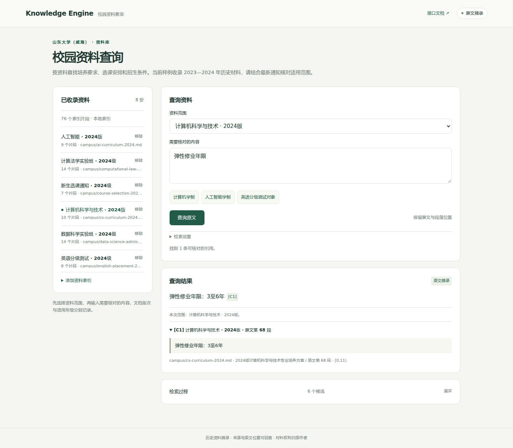
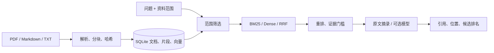

# RAG Knowledge Engine

[](https://github.com/FouHe0720/rag-knowledge-engine/actions/workflows/ci.yml)

[完整使用与技术手册](docs/USER_GUIDE.md) · [快速运行](#本地运行)

面向校园资料的检索与引用服务。导入培养方案、选课通知和实验班简章，按指定资料范围查找原文，保留出处、段落和检索过程。

样例来自山东大学（威海）知识库中的 8 份历史文档，覆盖 2023—2024 年。材料保留原始版本，用于查询和回归验证，不作为当前招生或办事依据。



## 一个具体问题

计算机科学与技术、人工智能两份 **2024版** 培养方案都写了 173 学分，弹性修业年限分别为 3 至 6 年、4 至 6 年。只按“学制”检索全部资料，容易把两个专业的内容混在一起。

查询接口接受 `sources`，在 BM25 / Dense 检索前筛选文档及对应向量，然后完成排序、证据筛选和引用。范围为空或指定文件未入库时返回无证据，不转查其他文档。网页可以直接切换这两份方案核对差别。

“2024版”是材料版本，不自动认定为“2024级”。原 DOCX 文件名、SHA-256、68 个入选段落的位置记录在 [来源清单](datasets/campus/manifest.json)。教师个人联系方式、名单和账号信息没有收入样例。

## 本地运行

需要 Python 3.11+ 和 uv，命令在仓库根目录执行。

```bash
make install
make campus-demo
make campus-serve
```

打开 <http://127.0.0.1:8000>。演示建立 `data/campus.sqlite3`，运行 20 条证据定位检查，写入 [逐题结果](results/campus.json)。重复导入不修改内容未变的文档，不需要模型下载或 API Key。

```bash
.venv/bin/rag --db data/campus.sqlite3 query '弹性修业年限' \
  --strategy bm25 --source campus/ai-curriculum-2024.md

# 可选：使用自己的原知识库复核文件哈希与 DOCX 段落
.venv/bin/python scripts/campus_sources.py --source-root /path/to/知识库
```

默认输出原文摘录。Dense 使用标为 `MOCK` 的 hash embedding，用于验证向量接口；校园示例默认使用 BM25。可配置真实 embedding 和 chat 服务，配置方式见 [.env.example](.env.example) 与 [演示文档](docs/DEMO.md)。

## 实现



- **入库一致性**：文档、片段和向量在同一 SQLite 事务中更新；失败保留旧索引。索引绑定模型、revision、维数和分块配置。
- **检索过程**：BM25、NumPy cosine、RRF 和词项重排独立实现，响应保留分数、排名与选择记录。
- **引用定位**：PDF 页码、Markdown 章节、TXT 段落及清洗后字符位置随结果返回；可选模型只使用已提供的引用 ID。
- **接口边界**：FastAPI 与 CLI 共用服务；文件摄取限制在语料根目录，PDF 有独立进程和资源预算。

`POST /documents` 入库，`GET /documents` 查清单，`POST /query` 查询，`DELETE /documents/{id}` 删除索引。完整参数见启动后的 `/docs`。

## 验证

```bash
make test
make lint
make annotations
make eval
```

Python 3.12 本地验证 **58 项测试通过**；有一条现有 Starlette/httpx 弃用提示。校园检查 **20/20** 通过，检查目标是能否找回指定资料、原文段落与关键字段，以及空范围是否拒答。这些题由实现者依据摘录编写，不是独立测试集，也不是模型问答准确率。

原有 8 份技术笔记、48 道检索题与引用审计保留为单独的技术基准，使用 `make demo` / `make eval`。结果见 [技术检索报告](results/offline.md)。校园数据不混入原基准分母。CI 同时执行技术评测与校园回归；远端结果以 Actions 为准。

## 取舍

当前面向本地小型知识库：SQLite + NumPy 扫描和每次查询构建 BM25，便于检查一致性，但不适合大规模并发。默认词项覆盖门槛不能理解否定、适用条件或政策时效，选定历史资料不等于核实当前政策；引用存在也不代表生成结论获得语义支持。页面默认仅在本机开放，没有账号或多租户权限。

[业务场景与来源](docs/CAMPUS.md) · [架构](docs/ARCHITECTURE.md) · [演示](docs/DEMO.md) · [验证记录](docs/VALIDATION.md) · [代码阅读](docs/CODE_WALKTHROUGH.md)

代码及原创技术笔记使用 [MIT](LICENSE)。学校材料摘录的权利归原作者，不随代码许可证重新授权。
