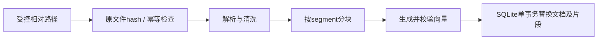
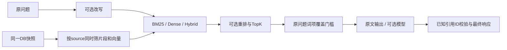

# RAG Knowledge Engine 使用与技术手册

本手册按“运行 → 操作 → 配置 → 实现”组织。命令均在仓库根目录执行，使用 Linux / WSL 的 Bash。默认模式不下载模型、不调用外部 API；安装依赖时需要网络或可用的本地缓存。

## 目录

- [1. 功能与运行方式](#1-功能与运行方式)
- [2. 安装和启动](#2-安装和启动)
- [3. 页面操作](#3-页面操作)
- [4. CLI 完整用法](#4-cli-完整用法)
- [5. HTTP API](#5-http-api)
- [6. 数据、来源与持久化](#6-数据来源与持久化)
- [7. 全部配置项](#7-全部配置项)
- [8. 真实向量、模型回答和查询改写](#8-真实向量模型回答和查询改写)
- [9. 评测、测试和容器](#9-评测测试和容器)
- [10. 项目结构与代码职责](#10-项目结构与代码职责)
- [11. 技术原理和执行链路](#11-技术原理和执行链路)
- [12. 排错与扩展](#12-排错与扩展)

## 1. 功能与运行方式

| 能力 | 入口 | 需要什么 |
|---|---|---|
| 校园资料查询 | `make campus-demo`、`make campus-serve` | 随仓库提供的历史摘录 |
| 技术笔记演示 | `make demo` | 4份演示资料；临时索引 |
| 文件入库、更新、删除 | CLI / HTTP / 页面 | 受控目录内的 PDF、Markdown、TXT |
| BM25、Dense、Hybrid | `query --strategy` | 已入库索引；默认向量为 hash Mock |
| 资料范围筛选 | CLI `--source`、HTTP `sources` | 已入库的安全相对路径 |
| 重排 | `--rerank lexical` | 词项覆盖基线，不需要模型 |
| 模型生成与查询改写 | compatible 配置、`--rewrite` | 操作者提供的兼容模型服务 |
| CPU语义向量 | `sentence_transformers` provider | 可选依赖和已缓存的模型 |
| 技术检索评测 | `make eval` | 独立的8份技术笔记与48道题 |
| 校园证据回归 | `scripts/campus_demo.py` | 8份摘录与20条证据检查 |

CLI和HTTP共享同一个Engine。项目没有账号、聊天历史、文档在线编辑、OCR、任意URL采集或文件上传接口。校园DOCX已转换成带段号的Markdown；通用解析器不直接接收DOCX。

## 2. 安装和启动

### 2.1 获取代码和安装

需要 Python 3.11+、Git、Make；推荐使用已安装的 `uv`。

```bash
git clone https://github.com/FouHe0720/rag-knowledge-engine.git
cd rag-knowledge-engine
python3 --version
make install
.venv/bin/rag --help
```

安装脚本优先使用uv，按 `requirements-dev.lock` 的版本和hash安装到 `.venv`，再以editable方式安装项目；缺少uv时使用标准venv。系统缺少venv/ensurepip时，先准备uv或Python的venv支持。

以下命令直接使用 `.venv/bin/...`，不要求激活环境。该仓库使用带hash的requirements锁文件，不使用 `uv sync --frozen`。

### 2.2 校园资料：最短运行路径

```bash
make campus-demo
make campus-serve
```

访问 <http://127.0.0.1:8000>；接口文档在 `/docs`。出现 `20/20` 表示校园证据回归通过。`campus-serve` 前台运行，按 `Ctrl+C` 停止，数据库保留。

两条命令各做一件事：

1. `campus-demo` 校验摘录清单、入库8份材料、运行20条检查，使用 `data/campus.sqlite3`，更新 `results/campus.json`。
2. `campus-serve` 启动HTTP和查询页，读取这份校园数据库；服务本身不会自动入库。

多项目并行运行时，使用本手册约定的 **8103** 端口：

```bash
RAG_DB=data/campus.sqlite3 .venv/bin/uvicorn \
  rag_engine.api.app:create_app --factory \
  --host 127.0.0.1 --port 8103
```

此时访问 <http://127.0.0.1:8103>。终端里的相对路径以启动目录为基准，请从仓库根目录启动。

### 2.3 保留既有数据、单独试用

下面的目录只用于本次试用，避免更新仓库里的示例报告：

```bash
RAG_GUIDE_DIR=$(mktemp -d)
.venv/bin/python scripts/campus_demo.py \
  --db "$RAG_GUIDE_DIR/campus.sqlite3" \
  --output "$RAG_GUIDE_DIR/campus-results.json"
RAG_DB="$RAG_GUIDE_DIR/campus.sqlite3" .venv/bin/uvicorn \
  rag_engine.api.app:create_app --factory --host 127.0.0.1 --port 8103
```

保留终端输出的临时目录路径。新终端没有原来的shell变量，需重新设置路径，或使用前一节固定的 `data/campus.sqlite3`。

### 2.4 通用技术笔记模式

```bash
make demo
.venv/bin/rag ingest all
.venv/bin/rag documents
make serve
```

`make demo` 在临时数据库演示WAL、RRF、中文引用和无结果拒答，退出后不保存索引。后面三条才创建/读取默认 `data/index.sqlite3`；`make serve` 默认端口8000。

`ingest all` 会扫描整个 `corpus/`，包括 `campus/`。因此它和只导入8份校园材料的 `campus-demo` 范围不同。

## 3. 页面操作

1. 左侧查看已入库文件、索引片段数；点击文件标题选择资料范围，也可以在查询框上方切换范围。
2. 输入要核对的内容，点击“查询原文”。三个快捷问题可直接切换计算机方案、人工智能方案和英语分级通知。
3. 结果默认是原文摘录；点击 `[C1]` 可展开对应引用并定位到资料、原文段号或PDF页码。
4. 展开“检索设置”选择BM25、Dense、Hybrid，选择重排方式和最多引用数。
5. 展开“检索过程”查看候选排名及分数。每个候选可查看 `bm25_score`、`dense_score`、`rrf_score`、`selected` 等实际记录。
6. “添加资料索引”读取 `corpus` 根目录内的相对路径；先把文件放入受控目录，页面不会上传文件。
7. 点击“移除”只删除索引，原始文件保留。再次添加同一路径即可重建。

切换资料范围或修改查询内容后，旧答案会清空。未入库的指定文件得到无证据提示，不会自动放宽成全库查询。向量接口为MOCK时，Dense/Hybrid只适合检查接口流程。

## 4. CLI 完整用法

### 4.1 命令结构

```text
rag [--db PATH] ingest SOURCE [--root DIRECTORY]
rag [--db PATH] query QUESTION [查询选项]
rag [--db PATH] documents
rag [--db PATH] delete DOCUMENT_ID
```

`--db` 是全局选项，放在子命令之前。CLI输出JSON，错误写到stderr并以非零状态退出。

### 4.2 入库、幂等更新与自有文件

```bash
.venv/bin/rag --db data/manual.sqlite3 ingest storage.md
.venv/bin/rag --db data/manual.sqlite3 ingest storage.md
.venv/bin/rag --db data/manual.sqlite3 ingest operations.pdf
.venv/bin/rag --db data/manual.sqlite3 ingest all --root corpus
```

第一次 `changed=true`；原始文件字节内容未变时第二次为 `changed=false`。修改文件后再次入库，会在同一事务中替换该文件的全部片段和向量。`all` 是按文件逐项处理，不是全语料原子事务；其中一个文件失败时，之前成功的文件仍已入库。

自有文件可放在 `corpus/team/guide.md` 后执行：

```bash
.venv/bin/rag --db data/team.sqlite3 ingest team/guide.md
```

也可以用 `--root /path/to/documents` 换受控根目录。查询时只需使用同一数据库；HTTP入库则须同步配置 `RAG_CORPUS_ROOT`。支持UTF-8 Markdown/TXT和有文本层的PDF；扫描PDF需先在外部完成OCR。

### 4.3 三种策略与重排

```bash
.venv/bin/rag --db data/campus.sqlite3 query '弹性修业年限' \
  --strategy bm25 --top-k 3 --source campus/cs-curriculum-2024.md

.venv/bin/rag --db data/campus.sqlite3 query '弹性修业年限' \
  --strategy dense --top-k 3 --source campus/cs-curriculum-2024.md

.venv/bin/rag --db data/campus.sqlite3 query '弹性修业年限' \
  --strategy hybrid --rerank lexical --top-k 3 \
  --source campus/cs-curriculum-2024.md
```

| 查询选项 | 默认 | 含义 |
|---|---|---|
| `--strategy` | `hybrid` | `bm25`、`dense`、`hybrid` |
| `--top-k` | `5` | 最多选取多少候选作为引用；还需通过证据门槛 |
| `--rerank` | `noop` | 保持顺序，或使用 `lexical` 词项覆盖重排 |
| `--source` | 未设置 | 可重复指定，限定资料相对路径 |
| `--rewrite` | 关闭 | 调用已配置的LLM改写检索查询 |

CLI默认Hybrid，网页默认BM25。`top_k` 必须不超过 `RAG_TOP_N`；证据门槛可能使最终引用数小于top_k。

### 4.4 多来源与空范围

```bash
.venv/bin/rag --db data/campus.sqlite3 query '弹性修业年限' \
  --strategy bm25 --top-k 5 \
  --source campus/cs-curriculum-2024.md \
  --source campus/ai-curriculum-2024.md
```

省略 `--source` 表示全库；重复选项表示这些来源的并集。CLI没有显式空列表语法；HTTP的 `sources: []` 可表达空范围。未知来源得到拒答；危险路径会被拒绝。

### 4.5 清单和删除

```bash
.venv/bin/rag --db data/campus.sqlite3 documents
```

从结果读取 `document_id`，再执行：

```bash
# 替换成清单返回的真实ID
.venv/bin/rag --db data/campus.sqlite3 delete DOCUMENT_ID
```

document_id是source的SHA-256前24位；改文件内容不会改变document_id。删除会级联删除片段和向量，不会删除源文件。项目没有重命名/迁移接口，来源路径改变后会成为另一个文档。

## 5. HTTP API

以下假设服务运行在8103。没有登录流程，也没有入站Bearer鉴权。

| 方法与路径 | 用途 |
|---|---|
| `GET /` | 内置查询页 |
| `GET /health` | 进程状态、向量provider标签、回答模式 |
| `GET /documents` | 文件、ID和片段清单 |
| `POST /documents` | 读取语料根目录内文件并入库 |
| `DELETE /documents/{document_id}` | 删除该文档的索引 |
| `POST /query` | 查询、重排、范围筛选及可选改写 |
| `GET /docs`、`GET /redoc`、`GET /openapi.json` | 交互文档与schema |
| `GET /docs/oauth2-redirect` | 文档UI辅助页，不表示实现了OAuth登录 |

### 5.1 健康、入库与清单

```bash
curl --fail-with-body -sS http://127.0.0.1:8103/health

curl --fail-with-body -sS http://127.0.0.1:8103/documents \
  -H 'Content-Type: application/json' \
  --data-binary '{"source":"campus/cs-curriculum-2024.md"}'

curl --fail-with-body -sS http://127.0.0.1:8103/documents
```

成功入库返回201、`document` 与 `changed`；重复入库仍返回201，但 `changed=false`。不支持URL、multipart上传和宿主机任意绝对路径。

### 5.2 查询请求

```bash
curl --fail-with-body -sS http://127.0.0.1:8103/query \
  -H 'Content-Type: application/json' \
  --data-binary '{
    "question":"弹性修业年限",
    "strategy":"bm25",
    "top_k":3,
    "rerank":"noop",
    "rewrite":false,
    "sources":["campus/ai-curriculum-2024.md"]
  }'
```

应能在引用中核对到人工智能方案的“4至6年”。`question` 为1–2000字符且不得全空白；`top_k` 在schema中允许1–100，Engine还要求不超过配置的候选数；`sources` 最多32项。额外的未知请求字段会被拒绝。

`sources=null` 或省略表示全库；`[]` 表示零文档；列表在检索前生效，不是对检索结果事后删选。以下返回正常的200和 `refused=true`：

```bash
curl --fail-with-body -sS http://127.0.0.1:8103/query \
  -H 'Content-Type: application/json' \
  --data-binary '{"question":"弹性修业年限","sources":[]}'
```

### 5.3 响应字段怎样阅读

| 字段 | 意义 |
|---|---|
| `mode` | `extractive` 原文，或 `generated` 模型生成 |
| `answer` | 可显示的文本；无证据时为“根据当前知识库无法确认” |
| `statements` | 每条正文与它使用的citation_ids |
| `citations` | 最终使用的引用，带source、chunk_id、位置和snippet |
| `candidates` | 候选、排名、分数与trace；范围已在此前筛选 |
| `refused` | 是否没有可输出的statements |
| `evidence_score` / `threshold` | 所选候选中的最大词项覆盖与门槛 |
| `original_query` / `retrieval_query` | 原问题及改写后的检索文本 |
| `source_scope` | 实际请求的来源范围，null为全库 |
| `embedding_kind` | `MOCK`、`REAL_API` 或 `REAL_CPU` |

`section` 是Markdown标题路径，`page` 是PDF一基页码，`paragraph` 是TXT段号。`start:end` 指向清洗后的片段所属segment，不是DOCX/PDF原始字节位置。`evidence_score` 不是正确概率。

### 5.4 删除与错误

```bash
# 将ID替换为 GET /documents 中的24位十六进制值
curl --fail-with-body -sS -X DELETE \
  http://127.0.0.1:8103/documents/DOCUMENT_ID
```

常见错误：

| HTTP / code | 原因和处理 |
|---|---|
| 400 `unsafe_path` | 路径不安全；改用受控根目录内相对路径 |
| 400 `query_input` | 问题或top_k超过Engine约束 |
| 400 `rewrite_unavailable` | 未配置LLM却开启改写 |
| 404 `source_not_found` | 文件不存在或解析后越出语料根目录 |
| 404 `document_not_found` | 删除了不存在的文档 |
| 409 `index_mismatch` | 模型身份、维数或分块配置与已有DB不一致 |
| 413 `request_size` / `document_size` | JSON体超过16KiB或文件超过上限 |
| 415 `unsupported_type` | 文件不是PDF/Markdown/TXT |
| 422 `validation_error` | 请求字段不符合schema |
| 502 `provider_error` / `provider_format` / `invalid_citations` | 模型HTTP、格式或引用校验失败 |
| 504 `provider_timeout` | 上游请求超时 |

错误体使用 `{"error":{"code":"...","message":"..."}}`。不同PDF资源超限有细分错误码；详见 `adapters/pdf_worker.py`。

## 6. 数据、来源与持久化

| 路径 | 内容 | 是否可重建 |
|---|---|---|
| `corpus/` | 8份原创技术笔记及校园摘录子目录 | 保留为源资料 |
| `datasets/campus/manifest.json` | 校区、版次、明确年级、DOCX原路径/哈希、摘录/段落 | 修改摘录时必须同步审查 |
| `datasets/campus/questions.json` | 20条校园证据回归 | 依据材料维护 |
| `data/index.sqlite3` | 通用CLI/HTTP默认索引 | 可重新入库 |
| `data/campus.sqlite3` | 校园独立索引 | `make campus-demo` |
| `results/campus.json` | 校园逐题候选、引用、断言结果及清单hash | 校园回归生成 |
| `results/offline.{json,md}` | 技术检索评测 | `make eval` |

SQLite使用WAL，运行中还可能出现 `-wal`、`-shm` 文件。备份运行中的库时应使用SQLite备份工具，或停止使用它的进程、等待连接关闭后再复制；不要只复制一个仍有未合并WAL的主文件。

### 来源复核

```bash
.venv/bin/python scripts/campus_sources.py
.venv/bin/python scripts/campus_sources.py --source-root /path/to/知识库
```

第一条复核仓库摘录与manifest，并重建Markdown逐字节比较；第二条另外核对原始DOCX文件hash及XML段落。DOCX段号按 `word/document.xml` 全部 `w:p` 的一基序号计数，包括空段和表格段。

这些命令是校验器，不是任意DOCX导入器。校园材料为2023—2024年历史摘录；“2024版”不自动等于“2024级”，老师联系方式与学生名单不在样例中。

## 7. 全部配置项

CLI和HTTP通过 `Settings` 读取进程环境及仓库当前目录的 `.env`，前缀为 `RAG_`。进程环境优先于 `.env`，未设置时使用下表默认值。`.env.example` 是样例，程序不会把它当实际配置。

```bash
cp -n .env.example .env
```

| 环境变量 | 默认值 | 约束 / 用途 |
|---|---|---|
| `RAG_DB` | `data/index.sqlite3` | SQLite文件；CLI `--db` 可覆盖 |
| `RAG_CORPUS_ROOT` | `corpus` | 允许入库的文件根目录 |
| `RAG_CHUNK_SIZE` | `600` | 每窗口字符数，32–8000 |
| `RAG_CHUNK_OVERLAP` | `100` | 非负且小于chunk_size |
| `RAG_EMBEDDING_PROVIDER` | `deterministic` | `deterministic` / `compatible` / `sentence_transformers` |
| `RAG_EMBEDDING_MODEL` | 空 | 真实向量模型名；非Mock时必填 |
| `RAG_EMBEDDING_REVISION` | 空 | 模型revision或部署版本；非Mock时必填 |
| `RAG_EMBEDDING_DIMENSION` | `128` | 8–8192，必须等于服务实报维数 |
| `RAG_ALLOW_MODEL_DOWNLOAD` | `false` | 是否允许CPU模型下载 |
| `RAG_MODEL_CACHE` | `models` | CPU模型缓存目录 |
| `RAG_API_BASE_URL` | 空 | 兼容服务base；embedding与chat共用 |
| `RAG_API_KEY` | 空 | 可选Bearer Key |
| `RAG_LLM_MODEL` | 空 | 生成/改写模型；配置后提供Rewriter |
| `RAG_ANSWER_PROVIDER` | `extractive` | `extractive` / `compatible`；后者要求LLM模型 |
| `RAG_REQUEST_TIMEOUT` | `20` | 秒，0.1–120 |
| `RAG_MAX_DOCUMENT_BYTES` | `5000000` | 字节，1–20000000 |
| `RAG_TOP_N` | `20` | 候选数，1–100；也是top_k运行时上限 |
| `RAG_RRF_K` | `60` | RRF平滑常数，1–1000，不是结果条数 |
| `RAG_EVIDENCE_THRESHOLD` | `0.25` | 词项覆盖门槛，0–1且不含0 |

启动host/port由uvicorn命令配置，不是 `RAG_PORT`。索引身份改变时使用新DB，不修改metadata强行绕过检查。

固定离线的 `scripts/demo.py`、`scripts/campus_demo.py` 与默认 `eval/run.py` 会忽略 `.env` 和正常 `RAG_*`，避免配置影响可复跑结果；普通CLI和HTTP遵循配置。

## 8. 真实向量、模型回答和查询改写

### 8.1 兼容HTTP服务

下列URL、模型和revision均为需要替换的占位配置：

```dotenv
RAG_EMBEDDING_PROVIDER=compatible
RAG_API_BASE_URL=https://api.example.com/v1
RAG_EMBEDDING_MODEL=your-embedding-model
RAG_EMBEDDING_REVISION=your-deployment-version
RAG_EMBEDDING_DIMENSION=384
RAG_ANSWER_PROVIDER=compatible
RAG_LLM_MODEL=your-chat-model
RAG_DB=data/real-index.sqlite3
```

在本机 `.env` 或进程环境设置自己的 `RAG_API_KEY`。适配器实际请求 `{base}/embeddings` 和 `{base}/chat/completions`；非本机服务要求HTTPS，不能在URL中嵌入用户名、密码、query或fragment。

```bash
.venv/bin/rag ingest all
.venv/bin/rag query '弹性修业年限' --strategy hybrid \
  --source campus/cs-curriculum-2024.md
.venv/bin/rag query '计算机专业可以读几年' --rewrite \
  --source campus/cs-curriculum-2024.md
```

入库时始终生成向量，所以即使随后只用BM25查询，真实embedding配置下的入库也会发起模型请求。BM25查询本身不调用embedding；Dense/Hybrid查询会额外请求问题向量。生成与改写各自可能调用chat。

兼容HTTP关闭环境代理、自动重定向和自动重试。embedding按32条分批，并检查index、数量、维数及有限数值；chat必须返回规定格式。更换模型、服务地址、revision或维数后重新使用新库入库。

兄弟 **LLM Gateway** 暴露的是自定义 `/v1/chat`，不提供 `/embeddings` 或完整 `/chat/completions`。不能直接把它的地址填进 `RAG_API_BASE_URL` 作为等价服务。

### 8.2 模型回答的协议

模型正文必须满足：

```json
{"statements":[{"text":"待输出的正文","citation_ids":["C1"]}]}
```

每条正文必须有已提供的citation ID；最多10条statement，每条最多2000字符。正文不允许自行插入 `[C1]` 一类标记，最终标记由服务渲染。证据不足可返回 `{"statements":[]}`。Schema通过只证明结构与ID合法，不证明语义支持。

`--rewrite` 要求已配置 `RAG_LLM_MODEL`。可只配置改写模型而维持 `RAG_ANSWER_PROVIDER=extractive`；检索使用改写文本，证据覆盖门槛仍按原始问题计算，资料范围保持不变。

### 8.3 本地CPU向量

```bash
uv pip install --python .venv/bin/python -e '.[cpu]'
```

此可选安装不由原有requirements锁文件固定，且会引入sentence-transformers/PyTorch。根据目标机器选择依赖和模型后配置：

```dotenv
RAG_EMBEDDING_PROVIDER=sentence_transformers
RAG_EMBEDDING_MODEL=sentence-transformers/all-MiniLM-L6-v2
RAG_EMBEDDING_REVISION=REPLACE_WITH_IMMUTABLE_MODEL_COMMIT
RAG_EMBEDDING_DIMENSION=384
RAG_ALLOW_MODEL_DOWNLOAD=false
RAG_MODEL_CACHE=models
RAG_ANSWER_PROVIDER=extractive
RAG_DB=data/cpu-index.sqlite3
```

该模型名仅用于说明配置，主要面向英文，不能据此保证校园中文召回效果。默认只读本地缓存；需要下载时由操作者显式开启 `RAG_ALLOW_MODEL_DOWNLOAD=true`。适配器固定CPU、关闭remote code、编码batch=16并归一化向量。

### 8.4 显式真实调用验证

```bash
# 需要真实embedding和compatible回答配置，可能产生模型费用
.venv/bin/python scripts/real_smoke.py --allow-network

# 只评测真实embedding，不运行模型生成
.venv/bin/python eval/run.py --real --output results/real-local
```

真实smoke使用临时DB，检查实际引用可解析；不会替代人工语义审阅。本手册的离线验证未调用这些外部服务。

## 9. 评测、测试和容器

### 9.1 两套评测各看什么

```bash
make annotations
make eval
.venv/bin/python scripts/campus_demo.py --output /tmp/rag-campus-results.json
```

- 技术集：48题、8份原创笔记、20条混合引用检查；校园目录不进入该评测分母。
- 校园集：20条作者编写的证据定位检查；检查原文段落、关键字段和无证据路径，不做独立语义质量评分。
- 技术指标：Recall@1/5、MRR@10、实际单次查询延迟。延迟包含读取和检索，不含生成，也不是吞吐压测。
- 引用检查含10条故意损坏样例，0.5这类比例不能解读为实际回答质量。

自定义输出可避免覆盖仓库报告：

```bash
.venv/bin/python eval/run.py --output /tmp/rag-technical-results
```

维护 `eval/questions.jsonl` 时，gold必须能解析到真实source、定位和原文；改变分块后先运行 `--validate-only`，不能静默跳过失败标注。

### 9.2 开发检查

```bash
make test
make lint
.venv/bin/python scripts/privacy_check.py
.venv/bin/python scripts/build_pdf.py
make lock
```

`build_pdf.py` 重建原创PDF，需dev依赖reportlab；`make lock` 重新解析依赖并改写两个锁文件，仅在有意更新依赖时执行。格式修改命令为 `make format`。

### 9.3 Docker / Compose

```bash
docker compose up --build -d
docker compose exec rag rag ingest all
curl --fail-with-body -sS http://127.0.0.1:8000/health
docker compose stop
docker compose down
```

仓库文件名是 `compose.yaml`。默认宿主端口8000，`rag-data`命名卷保存索引，语料目录只读挂载；`down` 不加 `-v` 会保留卷。容器使用非root UID10001，默认内存768MiB、CPU1，限制见Compose文件。关闭容器不会删除宿主语料。

需要8103且不使用默认Compose映射时，可运行单独容器：

```bash
docker build -t rag-knowledge-engine:manual .
docker run --rm --name rag-manual -d \
  -p 127.0.0.1:8103:8000 \
  -v rag-manual-data:/app/data rag-knowledge-engine:manual
docker exec rag-manual rag ingest all
docker stop rag-manual
```

`make docker-smoke` 会构建镜像并实际验证HTTP生命周期，包括PDF定位。容器没有宿主机模型或 `.env`；真实模型配置和网络可达性需另行传入。不要把已启动的日常数据库交给会做删除操作的HTTP smoke脚本。

## 10. 项目结构与代码职责

```text
.
├── src/rag_engine/
│   ├── cli.py                  # argparse入口，调用同一个Engine
│   ├── domain/
│   │   ├── models.py           # Segment/Chunk/Document/Hit/Citation/Answer
│   │   ├── contracts.py        # Parser/Chunker/Embedding/Store/Retriever抽象
│   │   └── errors.py           # 安全的公共错误码、消息和HTTP状态
│   ├── adapters/
│   │   ├── parsing.py          # 文本清洗、Markdown/TXT、PDF子进程、窗口分块
│   │   ├── pdf_worker.py       # 有资源限制的PDF提取
│   │   ├── embedding.py        # hash向量与shape校验
│   │   ├── sentence_embedding.py # 可选CPU模型
│   │   ├── compatible.py       # embedding/chat/rewrite HTTP协议
│   │   ├── similarity.py       # NumPy cosine
│   │   ├── retrieval.py        # BM25、Dense、RRF、Hybrid
│   │   └── reranking.py        # Noop和词项覆盖重排
│   ├── infra/
│   │   ├── config.py          # Settings和配置约束
│   │   ├── store.py           # SQLite事务、文档与向量存取
│   │   └── middleware.py      # 16KiB JSON体限制
│   ├── services/
│   │   ├── ingestion.py       # 路径、大小、幂等、解析、向量与事务编排
│   │   ├── engine.py          # 构建依赖、范围筛选、查询、引用与拒答
│   │   └── text.py            # SHA-256与中英文tokenization
│   └── api/
│       ├── app.py             # FastAPI lifespan、路由和错误映射
│       └── static/index.html  # 无构建步骤的查询页
├── corpus/                    # 原始技术资料；campus/是历史摘录
├── datasets/campus/           # 来源清单、校园回归题
├── eval/                      # 技术题、引用夹具和评测执行器
├── results/                   # 已审阅的结果快照
├── scripts/                   # 安装、demo、资料检查、smoke、隐私检查
├── tests/                     # 解析、索引、模型契约、API、评测及校园回归
├── docs/                      # 本手册、架构、技术取舍和验证记录
├── data/                      # 运行时SQLite，默认忽略
├── requirements*.lock        # 带hash的运行/开发依赖锁
├── .env.example              # 公开配置样例
├── Dockerfile / compose.yaml # 容器和持久化配置
└── Makefile                   # 常用命令汇总
```

`domain`不管理HTTP或SQLite；`adapters`实现具体解析和算法；`infra`提供运行配置与存储；`services`组织业务步骤；CLI/API只负责边界输入输出。

## 11. 技术原理和执行链路

### 11.1 入库：先完成计算，再原子替换



安全路径拒绝绝对路径、`..`、反斜杠、冒号、隐藏组件及控制字符，并解析符号链接确认文件仍在语料根目录。文件字节超限会在解析前拒绝。

清洗采用Unicode NFC、统一换行和空白，移除部分控制字符。Markdown按ATX标题路径分段，围栏代码内不识别标题；TXT按空行分段；PDF按页。窗口为600字符、100重叠，不是token窗口。

所有向量生成并验证成功后才替换文档；SQLite外键删除旧片段并在同一事务插入新文档、片段和向量，失败会回滚旧索引。网络请求不放在数据库写事务内。

### 11.2 查询：范围、候选、证据、输出



同一快照保证片段和向量位置对应。先过滤范围再构建检索器，避免目标文档在全库TopN中被挤掉；这也会让BM25词频统计基于所选范围。范围参数是查询选择，不是用户ACL。

### 11.3 BM25、Dense与RRF

中文使用单字和相邻双字，英文使用小写词项，不依赖额外分词模型。BM25按词频、逆文档频率和长度归一化评分，默认 `k1=1.5`、`b=0.75`。

```text
IDF(t) = log(1 + (N - df(t) + 0.5) / (df(t) + 0.5))
BM25(q,d) = Σ IDF(t) × f(t,d) × (k1+1) /
            (f(t,d) + k1 × (1-b + b × len(d)/avglen))
```

其中N为范围内片段数，df是含该词项的片段数，f是词项频次，len与avglen按token计数；求和遍历查询中的去重词项。

Dense通过NumPy计算 `dot(u,v)/(norm(u)×norm(v))` 的cosine并排序。默认向量对token做SHA-256带符号投影、再L2归一化；碰撞和同义表达都可能影响结果，它没有学到语义知识。查询时只保留正相似度候选。

Hybrid对两路排名使用：

```text
RRF(document) = Σ 1 / (rrf_k + rank)
```

排名从1开始。该方法避免直接相加不同尺度的BM25/cosine分数，但会丢失原分数间距，不保证总优于单路。

Lexical重排按查询token被片段覆盖的比例排序，相同覆盖率保持原排名优先。它只能调整已有候选，不能找回未进入TopN的证据。

### 11.4 引用与拒答

每个通过门槛的所选片段获得 `C1` 等ID；extractive直接返回片段文本，compatible必须返回合法statement/ID。最终只保留正文使用到的引用。

无statement时拒答。词项覆盖不能判断否定、最新政策或条件蕴含；一条真实引用也可能被用来支持错误改写。因此引用完整性与语义正确性分别评估。

### 11.5 索引身份、PDF与资源

索引fingerprint绑定模型identity、维数、分块大小/重叠和清洗版本。Compatible模型identity还包含base URL摘要、模型名及显式revision；同名远程模型背后的权重变化仍需操作者管理revision。

PDF固定子进程通过stdin接收字节，不传shell或任意路径；限制100页、累计100万字符、单页内容流800万字节。父进程超时12秒，worker CPU软/硬限制8/9秒，在解释器基线虚拟地址空间之上限制256MiB headroom。这不是完整OS沙箱。

每次查询都会读取全量快照并重建BM25，Dense为精确扫描。适合小型本地库；扩大到大量文件或高并发需增量稀疏索引、ANN、访问控制和资源调度。

## 12. 排错与扩展

| 现象 | 先检查 | 操作 |
|---|---|---|
| 页面没有文件 | 服务读取的DB是否就是入库DB | 显式指定相同 `RAG_DB`；校园用campus.sqlite3 |
| CLI有数据、网页没数据 | 两终端的工作目录和环境 | 检查相对路径及 `.env`；不要混用index/campus库 |
| 8103已被占用 | 已有进程或另一个仓库 | 停止自己启动的进程，或换一个显式端口 |
| 出现 `index_mismatch` | 是否改了模型/维数/chunk参数 | 换新DB重新入库，保留旧库待核对 |
| 指定资料没有结果 | source是否与清单完全一致 | 先运行documents；路径匹配区分目录和文件名 |
| 看似相关却拒答 | TopK和词项门槛 | 检查candidates、原问题覆盖、资料范围及同义词问题 |
| 历史资料回答不了今年安排 | 数据并非当前通知 | 补充新材料；不要通过调低门槛制造答案 |
| PDF为空或报错 | 是否扫描/加密/超预算 | 先处理OCR/解密或拆分材料 |
| `cpu_model_unavailable` | cpu依赖、模型缓存和revision | 准备对应模型，确认下载策略和维数 |
| `provider_format` | 第三方协议与实际响应 | 核对embedding index和chat content，而非盲目重试 |
| 开了rewrite却不能用 | LLM模型和base URL | 配齐改写模型，或关闭rewrite |

阅读实现时，可按 `parsing.py → ingestion.py → store.py → retrieval.py → engine.py → eval/run.py` 跟踪一次请求。替换向量provider实现 `EmbeddingProvider`，替换重排实现 `Reranker`，新增解析类型实现 `DocumentParser`；任何修改都应保留定位、索引身份和引用检查。

现有的 [架构](ARCHITECTURE.md)、[技术决策](TECH_DECISIONS.md)、[校园来源](CAMPUS.md)、[评测协议](../eval/README.md) 提供对应设计细节。


## 附：手册示例核对

本手册通过当前CLI帮助、19个Settings字段及实际OpenAPI字段核对。使用独立临时数据库执行了入库、重复入库、指定来源查询、清单与删除；校园20条检查通过。实际HTTP核对了健康、入库/幂等、清单、查询、空范围、删除及页面/接口文档；另从ResearchOS环境调用RAGAdapter，返回3个带类型和来源标记的检索结果。

这些核对未改写既有索引、报告或原始材料。真实模型、CPU权重下载与Docker命令未在本次手册核对中执行。
